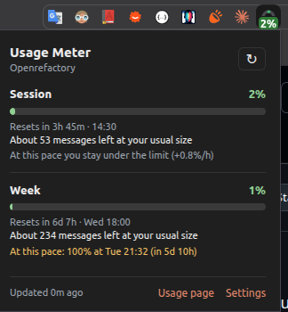
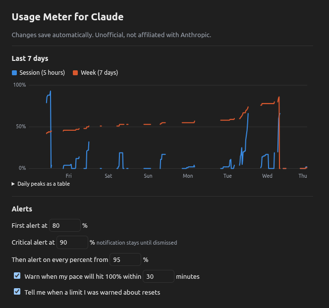
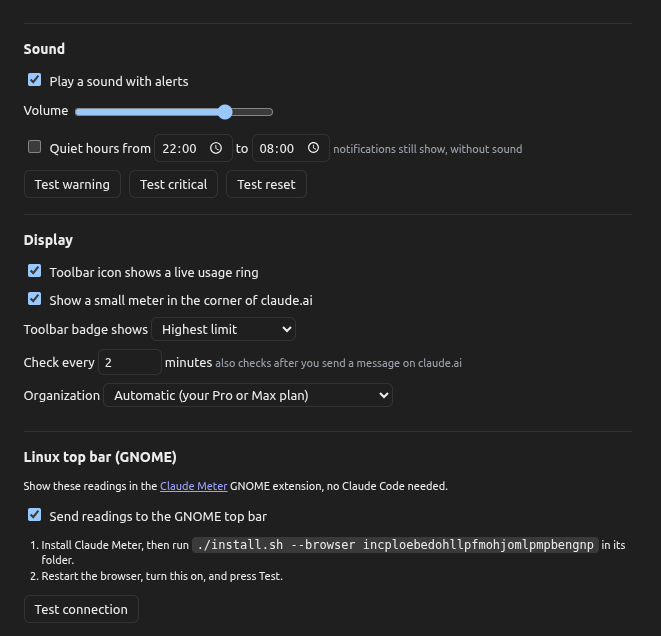
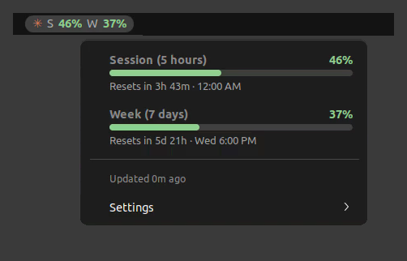
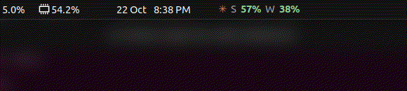
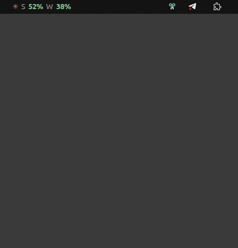

# Claude Meter

See your Claude session and weekly usage limits at a glance, with sound alerts before you run out. Two tools, use either or both:

| | Where it shows | Reads usage from | Platform |
| --- | --- | --- | --- |
| [**Usage Meter for Claude**](#usage-meter-for-claude-browser-extension) | Browser toolbar and the claude.ai page | claude.ai, with your existing login | Chrome, Brave, Edge and other Chromium browsers |
| [**Claude Meter for GNOME**](#claude-meter-for-gnome-top-bar) | GNOME top bar | Claude Code, or the browser extension | Linux with GNOME Shell |

Use the browser extension if you mostly chat on claude.ai, and the GNOME extension if you live in Claude Code. Together, the browser extension feeds the top bar, so it updates even without Claude Code.

> Unofficial community project. Not affiliated with or endorsed by Anthropic.

---

## Usage Meter for Claude (browser extension)

<p>
  
</p>

### What it does

- **Real limits, not estimates.** Reads the same numbers claude.ai shows on Settings > Usage: the 5-hour session limit, the weekly limit, and any model-specific weekly limits on your plan.
- **Live toolbar icon.** The icon is a ring that fills up with your usage, green, then yellow at 80% and red at 90%. A badge shows the exact percentage.
- **Meter on claude.ai.** A small pill in the corner of the page shows Session, Week and messages left while you write.
- **Messages left.** Learns how much one of your messages usually costs and estimates how many you have left, for example "About 14 messages left".
- **Alerts with sound** at 80% and 90%, then at every percent from 95%, for each limit. The 90% alert stays on screen until you dismiss it. Sounds play even when no claude.ai tab is open.
- **Pace forecast.** From your last hour of use it estimates when you will hit 100%, and warns you if that is less than 30 minutes away and before the limit resets.
- **Reset notice** right when a limit you were warned about resets.
- **Quiet hours** that silence sounds but keep notifications.
- **7-day history chart** of session and weekly usage.
- **GNOME top bar (optional).** Feeds [Claude Meter for GNOME](#claude-meter-for-gnome-top-bar), so the top bar works without Claude Code.
- **Private.** No servers, no analytics, no account. The only requests go to claude.ai, using your existing login. See [PRIVACY.md](browser-extension/PRIVACY.md).

### Settings

Thresholds, sounds, volume, quiet hours, the badge, the icon ring and the page meter are all adjustable in Settings, along with the 7-day history.





### Install (developer mode)

1. Download `usage-meter-for-claude-<version>.zip` from the [latest release](https://github.com/AtiQ-Rahman/claude-meter/releases) (not "Source code") and unzip it.
2. Open `chrome://extensions` (Brave: `brave://extensions`, Edge: `edge://extensions`).
3. Turn on **Developer mode**.
4. Click **Load unpacked** and select the unzipped `usage-meter-for-claude` folder. (From a clone of this repository, select the `browser-extension` folder instead.)
5. Make sure you are logged in to claude.ai, then click the extension icon in the toolbar. Pin it to keep the meter visible.

### How it works

The background worker asks claude.ai for your organization and its usage every 2 minutes, about 30 seconds after you send a message on claude.ai, and right after a limit resets. If the direct request is blocked, it makes the same request from an open claude.ai tab.

claude.ai does not document this data, so it can change without notice. If the popup shows an error, open **Settings > Diagnostics** to see what claude.ai returned, and please open an issue.

### Permissions

| Permission | Why |
| --- | --- |
| `claude.ai` access | Read your usage with your existing login, and show the page meter |
| `storage` | Settings, the latest reading, and 7 days of history |
| `alarms` | Check usage on a schedule and right after a reset |
| `notifications` | Alerts |
| `offscreen` | Play alert sounds (background workers can't play audio) |
| `nativeMessaging` (optional) | Only if you turn on the GNOME top bar |

---

## Claude Meter for GNOME (top bar)

Live Claude usage in your GNOME top bar, like a system monitor for your Claude limits.



```
✳ S 38%  W 35%
```

- **S**: session usage (the rolling 5-hour limit)
- **W**: weekly usage (the 7-day limit)
- Colors: green below 80%, yellow from 80%, red from 90%
- Alerts with sound at 80% and 90%, then at every percent from 95%

Click the indicator for progress bars, time until each limit resets, and when the data was last updated.

### How it works

Claude Code passes usage data, including your rate limits, to its [status line](https://docs.claude.com/en/docs/claude-code/statusline) command. `statusline.sh` saves that data to `~/.cache/claude-meter/usage.json`, and the GNOME extension reads the file every 10 seconds.

No API calls, no credentials, and no network access. Everything stays on your machine.

Because of this, the meter updates while you use Claude Code. Usage from claude.ai in the browser shows up the next time Claude Code reports, unless you [connect the browser extension](#feed-it-from-the-browser-extension). If the data is older than 15 minutes, the numbers turn grey.

### Requirements

- Claude Code with a Claude subscription (Pro or Max), or the browser extension. Rate limit data is only sent for subscription accounts.
- GNOME Shell 42 (tested on Ubuntu 22.04, X11)
- `jq`

### Install

```bash
git clone https://github.com/AtiQ-Rahman/claude-meter.git
cd claude-meter
./install.sh
```

Then restart GNOME Shell (X11: `Alt+F2`, type `r`, `Enter`. Wayland: log out and back in) and send any message in Claude Code.

The installer:

1. Sets `statusLine` in `~/.claude/settings.json` to this repo's `statusline.sh` (your old file is saved as `settings.json.bak`)
2. Links `gnome-extension/` into `~/.local/share/gnome-shell/extensions/` and enables it

Keep the cloned folder where it is. The status line and the extension both point to it.

### Feed it from the browser extension

1. Install Claude Meter for GNOME with `./install.sh`.
2. In the browser extension's Settings, under **Linux top bar**, copy the command shown (it includes the extension's ID) and run it in the repository folder, for example `./install.sh --browser abcdefghijklmnopabcdefghijklmnop`.
3. Restart the browser, turn on **Send readings to the GNOME top bar**, allow the permission, and press **Test connection**.

This uses the optional `nativeMessaging` permission, which is only requested when you turn it on.

### Alerts

When session or weekly usage crosses a threshold, Claude Meter plays a sound and shows a notification:

| Usage | Sound | Notification |
| --- | --- | --- |
| 80% | warning | normal |
| 90% | alert | stays until you dismiss it, and the indicator turns red |
| 95%, 96%, ... 100% | alert, every percent | updated with the new value |



Each alert fires once per limit window, and the count starts over when the limit resets. Sounds play through `paplay`, so they play even when desktop event sounds are turned off. Turn alerts off with **Usage alerts (sound)** in Settings.

### Settings

Open the indicator and go to **Settings**:

- **Show Session (S)** / **Show Week (W)**: show or hide each value in the top bar
- **Usage alerts (sound)**: turn alerts on or off (on by default)
- **Position in top bar**: Left, Center or Right



Settings are saved in `~/.config/claude-meter/settings.json`.

### Terminal status line

Because usage now lives in the top bar, the Claude Code status line only shows the model and context usage:

```
Opus 5.5 · ctx 6%
```

`ctx` is how full the current conversation's context window is. To show session and weekly usage in the terminal as well, set `CLAUDE_USAGE_FULL_LINE=1` in the status line command:

```json
"statusLine": { "type": "command", "command": "CLAUDE_USAGE_FULL_LINE=1 /path/to/claude-meter/statusline.sh" }
```

### Uninstall

```bash
./install.sh --uninstall
```

Remove the browser extension from `chrome://extensions`.

---

## Publishing the browser extension

`browser-extension/package.sh` builds two zips in `dist/`: `usage-meter-for-claude-<version>.zip` for GitHub releases (unzips to one folder for Load unpacked) and `usage-meter-for-claude-<version>-webstore.zip` for the Chrome Web Store. The privacy policy for the listing is [PRIVACY.md](browser-extension/PRIVACY.md).

## Contributing

Anyone is welcome to modify, fork or improve this project. Issues and pull requests are welcome.

## License

[MIT](LICENSE)
