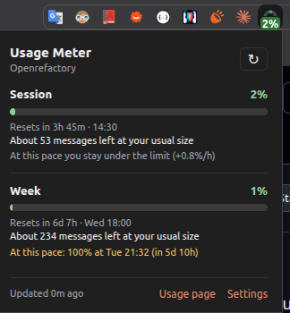
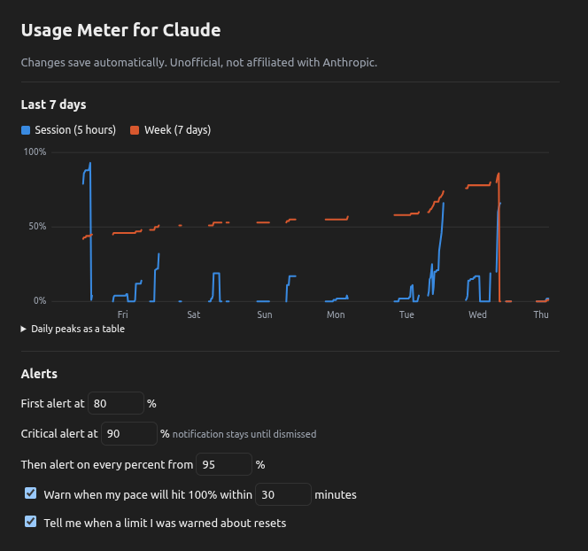
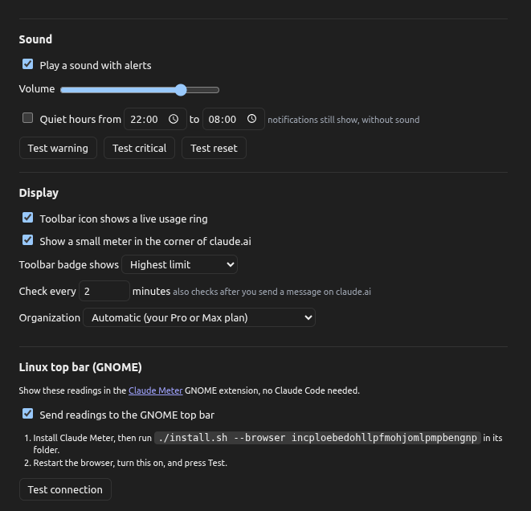
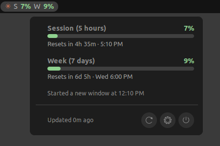
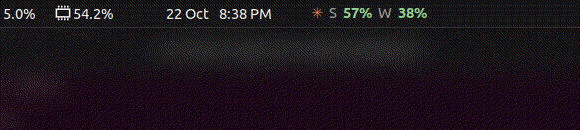
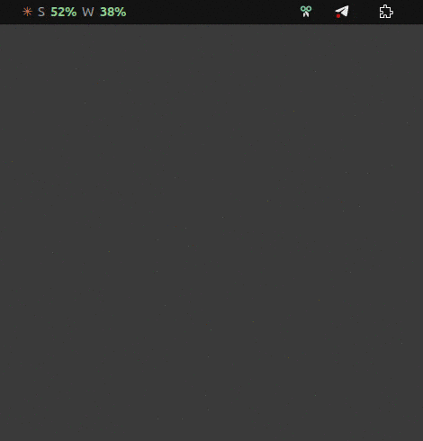

# Claude Meter

See your Claude session and weekly usage limits at a glance, with sound alerts before you run out. Two tools, use either or both:

| | Where it shows | Reads usage from | Platform |
| --- | --- | --- | --- |
| [**Usage Meter for Claude**](#usage-meter-for-claude-browser-extension) | Browser toolbar and the claude.ai page | claude.ai, with your existing login | Chrome, Brave, Edge and other Chromium browsers |
| [**Claude Meter for GNOME**](#claude-meter-for-gnome-top-bar) | GNOME top bar | Claude Code, or the browser extension | Linux with GNOME Shell |

Use the browser extension if you mostly chat on claude.ai, and the GNOME extension if you live in Claude Code. Together, the browser extension feeds the top bar, so it updates even without Claude Code.

> Unofficial community project. Not affiliated with or endorsed by Anthropic.


Watch the [full video with sound](video/usage-meter-for-claude.mp4).

---

## Usage Meter for Claude (browser extension)

<p>
  
</p>

### What it does

- **Real limits, not estimates.** Reads the same numbers claude.ai shows on Settings > Usage: the 5-hour session limit, the weekly limit, any model-specific weekly limits on your plan, and extra usage.
- **Live toolbar icon.** The icon is a ring that fills up with your usage, green, then yellow at 80% and red at 90%. A badge shows the exact percentage.
- **Meter on claude.ai.** A small pill in the corner of the page shows Session, Week and messages left while you write.
- **Messages left.** Learns how much one of your messages usually costs and estimates how many you have left, for example "About 14 messages left".
- **Alerts with sound** at 80% and 90%, then at every percent from 95%, for each limit. The 90% alert stays on screen until you dismiss it. Sounds play even when no claude.ai tab is open.
- **Pace forecast.** From your last hour of use it estimates when you will hit 100%, and warns you if that is less than 30 minutes away and before the limit resets.
- **Reset notice** right when a limit you were warned about resets.
- **Quiet hours** that silence sounds but keep notifications.
- **7-day history chart** of session and weekly usage.
- **GNOME top bar (optional).** Feeds [Claude Meter for GNOME](#claude-meter-for-gnome-top-bar), so the top bar works without Claude Code.
- **Private.** No servers, no analytics, no account. The only requests go to claude.ai, using your existing login. See [PRIVACY.md](browser-extension/PRIVACY.md).

### Settings

Thresholds, sounds, volume, quiet hours, the badge, the icon ring and the page meter are all adjustable in Settings, along with the 7-day history.





### Install (developer mode)

1. Download `usage-meter-for-claude-<version>.zip` from the [latest release](https://github.com/AtiQ-Rahman/claude-meter/releases) (not "Source code") and unzip it.
2. Open `chrome://extensions` (Brave: `brave://extensions`, Edge: `edge://extensions`).
3. Turn on **Developer mode**.
4. Click **Load unpacked** and select the unzipped `usage-meter-for-claude` folder. (From a clone of this repository, select the `browser-extension` folder instead.)
5. Make sure you are logged in to claude.ai, then click the extension icon in the toolbar. Pin it to keep the meter visible.

### How it works

The background worker asks claude.ai for your organization and its usage every 2 minutes, about 30 seconds after you send a message on claude.ai, and right after a limit resets. If the direct request is blocked, it makes the same request from an open claude.ai tab.

claude.ai does not document this data, so it can change without notice. If the popup shows an error, open **Settings > Diagnostics** to see what claude.ai returned, and please open an issue.

### Permissions

| Permission | Why |
| --- | --- |
| `claude.ai` access | Read your usage with your existing login, and show the page meter |
| `storage` | Settings, the latest reading, and 7 days of history |
| `alarms` | Check usage on a schedule and right after a reset |
| `notifications` | Alerts |
| `offscreen` | Play alert sounds (background workers can't play audio) |
| `nativeMessaging` (optional) | Only if you turn on the GNOME top bar |

---

## Claude Meter for GNOME (top bar)

Live Claude usage in your GNOME top bar, like a system monitor for your Claude limits.



```
✳ S 38%  W 35%
```

- **S**: session usage (the rolling 5-hour limit)
- **W**: weekly usage (the 7-day limit)
- Colors: green below 75%, yellow from 75%, red from 90%, in the top bar and the menu
- Alerts with sound at 80% and 90%, then at every percent from 95%

Click the indicator for progress bars, time until each limit resets, and when the data was last updated. The [menu](#menu) also refreshes, opens the settings and the log, and quits.

### How it works

Claude Code passes usage data, including your rate limits, to its [status line](https://docs.claude.com/en/docs/claude-code/statusline) command. `statusline.sh` saves that data to `~/.cache/claude-meter/usage.json`, and the GNOME extension reads the file every 10 seconds.

No API calls, no credentials, and no network access. Everything stays on your machine, unless you turn on [Plan and model limits](#plan-and-model-limits) or [Smart quota refresh](#smart-quota-refresh).

Because of this, the meter updates while you use Claude Code. Usage from claude.ai in the browser shows up the next time Claude Code reports, unless you [connect the browser extension](#feed-it-from-the-browser-extension). If the data is older than 15 minutes, the numbers turn grey.

### Requirements

- Claude Code with a Claude subscription (Pro or Max), or the browser extension. Rate limit data is only sent for subscription accounts.
- GNOME Shell 42 to 51
- `jq`

### Install

```bash
git clone https://github.com/AtiQ-Rahman/claude-meter.git
cd claude-meter
./install.sh
```

Then restart GNOME Shell (X11: `Alt+F2`, type `r`, `Enter`. Wayland: log out and back in) and send any message in Claude Code.

The installer:

1. Sets `statusLine` in `~/.claude/settings.json` to this repo's `statusline.sh` (your old file is saved as `settings.json.bak`)
2. Compiles the settings schema, then links `gnome-extension/` into `~/.local/share/gnome-shell/extensions/` and enables it. On GNOME 42-44 it links `build/legacy/` instead, a copy converted for the older extension format.

Run `./install.sh` again after updating the repository: it compiles the settings schema, which the extension needs to start.

Keep the cloned folder where it is. The status line and the extension both point to it.

### Feed it from the browser extension

1. Install Claude Meter for GNOME with `./install.sh`.
2. In the browser extension's Settings, under **Linux top bar**, copy the command shown (it includes the extension's ID) and run it in the repository folder, for example `./install.sh --browser abcdefghijklmnopabcdefghijklmnop`.
3. Restart the browser, turn on **Send readings to the GNOME top bar**, allow the permission, and press **Test connection**.
4. To see per-model limits and extra usage in the top bar's menu too, turn on [Plan and model limits](#plan-and-model-limits) in its Settings.

This uses the optional `nativeMessaging` permission, which is only requested when you turn it on.

### Alerts

When session or weekly usage, or a per-model weekly limit from [Plan and model limits](#plan-and-model-limits), crosses a threshold, Claude Meter plays a sound and shows a notification:

| Usage | Sound | Notification |
| --- | --- | --- |
| 80% | warning | normal |
| 90% | alert | stays until you dismiss it, and the indicator turns red |
| 95%, 96%, ... 100% | alert, every percent | updated with the new value |



Each alert fires once per limit window, and the count starts over when the limit resets. Sounds play through `paplay`, so they play even when desktop event sounds are turned off. Turn alerts off with **Usage alerts (sound)** in Settings.

### Menu

Below the usage rows:

| Item | Shortcut | What it does |
| --- | --- | --- |
| **Refresh now** | Ctrl+R | Reads the usage files again and, with [Plan and model limits](#plan-and-model-limits) on, asks for them right away. The menu stays open. |
| **Smart quota refresh** | | Turns [Smart quota refresh](#smart-quota-refresh) on or off. The line below it says what it last did. |
| **Settings…** | Ctrl+, | Opens the settings window |
| **View logs** | | Opens the log in your text editor |
| **Version** | | The version you're running |
| **Quit Claude Meter** | Ctrl+Q | Hides Claude Meter until you log in again. To bring it back sooner, switch it off and on in the Extensions app. |

The shortcuts work while the menu is open.

### Settings

Choose **Settings…** in the menu, or open Claude Meter's settings in the Extensions app:

- **Show Session (S)** / **Show Week (W)**: show or hide each value in the top bar
- **Position in top bar**: Left, Center or Right
- **Usage alerts (sound)**: turn alerts on or off (on by default)
- **Plan and model limits**: add your plan, per-model weekly limits and extra usage to the menu (off by default, see below)
- **Smart quota refresh**: start a new session window as soon as one ends (off by default, see below)



Settings are kept in GSettings, under `/org/gnome/shell/extensions/claude-meter/`. Versions before 1.0.0 kept them in `~/.config/claude-meter/settings.json`; the first start of a newer version moves them over and removes that file.

### Plan and model limits

Claude Code's status line only reports the session and weekly limits. Turn on **Plan and model limits** to also show:

- your plan, for example `Max (5x)`, next to the update time
- weekly limits that apply to one model, for example **Week · Fable**, with the same alerts as session and week. When one is at 90% or more, the indicator turns red even if session and week are fine.
- extra usage: how much of your monthly extra-usage limit you've spent, or why it's off

These come from one of two places, whichever reported last:

- **Claude Code's login.** If you use Claude Code, the extension reads the login it saves in `~/.claude/.credentials.json` and sends it to `https://api.anthropic.com/api/oauth/usage`, the same request Claude Code's `/usage` makes. It does this every 5 minutes and when you open the menu, waits longer when Anthropic says there were too many requests, and saves the result to `~/.cache/claude-meter/account.json`. The login is never sent anywhere else.
- **The browser extension**, if you [connected it](#feed-it-from-the-browser-extension). It saves its reading to `account.json` in the same folder.

If the rows are more than 15 minutes old they turn grey, and a line under the update time says why. The extension never renews Claude Code's login itself, because that would sign Claude Code out. When the login expires, which happens a few hours after you last used Claude Code, the menu says so, and the rows update again once you open Claude Code. The usage endpoint is not a documented API, so a change on Anthropic's side can break these rows. The session and weekly values from the status line keep working either way.

### Smart quota refresh

The 5-hour session limit's window starts with your first message after the last window ended. If you start working at 12:00 and hit the limit at 14:00, you wait until 17:00. Had the window started at 10:00, you would wait only until 15:00.

With **Smart quota refresh** on, Claude Meter starts a new window as soon as the last one ends. It sends one tiny message through Claude Code:

```bash
claude -p "Reply with OK." --model haiku --tools "" --no-session-persistence \
  --strict-mcp-config --disable-slash-commands --settings '{"disableAllHooks": true}'
```

That is the smallest model, with no tools, MCP servers, hooks or slash commands, and nothing saved to Claude Code's history. It counts toward your usage like any message, but it is tiny. Claude Code uses its own login, and renews it when needed.

- It needs Claude Code, as `claude` on your PATH or in `~/.local/bin`.
- It sends at most one message per window. If one fails, it tries again after 30 minutes, and the line under the switch says what went wrong. [View logs](#logs) has the details.
- It knows a window ended from the last reading of Claude Code, the browser extension or the usage API. If you used Claude elsewhere in the meantime, at worst one message is sent into a window that was already running.
- GNOME turns extensions off while the screen is locked, so it starts the window once you unlock.

It is off by default.

### Logs

**View logs** opens `~/.cache/claude-meter/claude-meter.log`: when Claude Meter started, alerts, each request to the usage API and its outcome, and what Smart quota refresh did. Past 256 KB it starts over and keeps the previous log as `claude-meter.log.old`.

### Terminal status line

Because usage now lives in the top bar, the Claude Code status line only shows the model and context usage:

```
Opus 5.5 · ctx 6%
```

`ctx` is how full the current conversation's context window is. To show session and weekly usage in the terminal as well, set `CLAUDE_USAGE_FULL_LINE=1` in the status line command:

```json
"statusLine": { "type": "command", "command": "CLAUDE_USAGE_FULL_LINE=1 /path/to/claude-meter/statusline.sh" }
```

### Uninstall

```bash
./install.sh --uninstall
```

To also forget the settings: `dconf reset -f /org/gnome/shell/extensions/claude-meter/`. Remove the browser extension from `chrome://extensions`.

---

## Developing the GNOME extension

`gnome-extension/` is written for GNOME 45 and later. `dev/build-legacy.sh` converts it for GNOME 42-44, so keep its imports to the one-line forms that script handles. Run `make help` for the full list of targets; the main ones:

- `make install`: compile the settings schema, then link and enable the extension (your session loads it at next login)
- `make prefs`: open the settings window
- `make nested`: run GNOME Shell in a window with the extension loaded and a fresh fake reading (session 38%, week 35%, Fable week 12%; `make nested S=92 W=40 M=63` to change it); restart it after each change. GNOME 49 and later need `mutter-dev-bin` for this. It has its own settings, enabled extensions and runtime directory in `.dev/nested`, so your session is left alone. Turn on **Plan and model limits** in its settings to see the account rows; it never calls the real usage API.
- `make fake S=92 W=40 M=63`: change the nested shell's reading while it runs
- `make unit`: quick tests without GNOME Shell. The GNOME and browser extension parsers and the native host must all turn the real response in `dev/fixtures/usage-response.json` into `dev/fixtures/usage-parsed.json`, and Smart quota refresh must start windows only when it should (needs `gjs`, `python3` and `jq`; `node` for the browser extension)
- `make test`: `make unit`, then a headless smoke test on your GNOME Shell with a fake login, usage API, browser reading and Claude Code, which also opens the settings window and uses the menu's shortcuts
- `make test-all`: the same test on GNOME 42 to 51, each in a throwaway Docker container (downloads about 1 GB per version, keeps nothing but the Alpine base images)
- `make pack`: build the extension zips for GNOME 45-51 and 42-44 (needs `zip`)
- `make lint`: build the zips and check them with [shexli](https://pypi.org/project/shexli/), the analyzer extensions.gnome.org's review guidelines recommend. It installs shexli into `.dev/shexli` with tree-sitter 0.25, because tree-sitter 0.26 makes shexli crash with a segmentation fault. Run shexli on the zip you upload, not on the repository: on a folder over 50 MB it stops with "Package exceeds total file size limit". shexli 0.2.1 calls GNOME 51 an "implausible future release", as it predates it; `make lint` lets that one finding pass.

## Releasing

Push a tag that matches `version-name` in `gnome-extension/metadata.json`, for example:

```bash
git tag v1.0.0 && git push origin v1.0.0
```

The [Release workflow](.github/workflows/release.yml) then runs the unit tests, the smoke test on GNOME 42 to 51 and `make lint`, and publishes a GitHub release with:

| File | For |
| --- | --- |
| `claude-meter-gnome-<version>.shell-extension.zip` | GNOME 45-51: `gnome-extensions install`, or upload to extensions.gnome.org |
| `claude-meter-gnome-<version>-gnome42-44.shell-extension.zip` | GNOME 42-44 |
| `usage-meter-for-claude-<version>.zip` | the browser extension: unzips to one folder for Load unpacked |
| `usage-meter-for-claude-<version>-webstore.zip` | the Chrome Web Store |
| `SHA256SUMS` | checksums of the four |

A tag with a hyphen, such as `v1.1.0-beta.1`, makes a prerelease. To build and test without releasing, run the workflow from the Actions tab; the files are kept as its `release-files` artifact. `make release` builds the same files locally in `dist/release`.

The browser extension's version is the one in `browser-extension/manifest.json`; `browser-extension/package.sh` builds just its two zips. The privacy policy for the Chrome Web Store listing is [PRIVACY.md](browser-extension/PRIVACY.md).

## Contributing

Anyone is welcome to modify, fork or improve this project. Issues and pull requests are welcome.

## License

[MIT](LICENSE)
